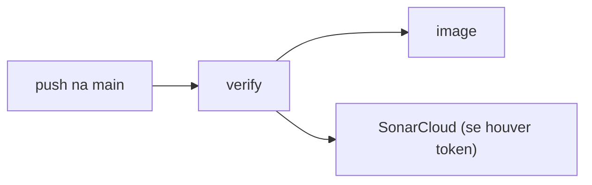

# CI Pipeline — farejador-pr-reviewer

Data: 2026-11-20. Estágio 3.7 (uma vez). O arquivo é `.github/workflows/ci.yml`. **Nada foi enviado ao GitHub nem habilitado remotamente**: o workflow só passa a rodar depois que o repositório receber o primeiro push na `main`, que depende de uma decisão sua.

## Gatilho e política

- Roda em **push na `main`** (A6: commits direto na `main`, sem branches).
- `permissions: contents: read` (privilégio mínimo) e `concurrency` com cancelamento de execuções antigas da mesma referência.
- Sem gatilho de `pull_request`: o projeto não usa PRs próprios (A7).

## Jobs e portões

| Job | Passos | Falha se |
|---|---|---|
| `verify` | `uv sync --frozen`; `ruff check .` (inclui as regras de segurança `S`); `ruff format --check .`; `mypy src`; `pytest` com `--cov-fail-under=80` e `coverage.xml`; scan do SonarCloud | lint, formatação, tipos ou testes falham, ou a cobertura fica abaixo de 80% (NFR-10); o scan do Sonar só roda quando o segredo `SONAR_TOKEN` existe |
| `image` (depende de `verify`) | `docker build`; `farejador version` dentro do contêiner e verificação de usuário não-root; validação dos dois perfis do compose com variáveis descartáveis | o build da imagem falha, o contêiner roda como root ou os perfis do compose são inválidos |

O comando de verificação aprovado (`ruff`, `ruff format --check`, `mypy`, `pytest` com cobertura de 80%) é exatamente o que o job `verify` executa; o job `image` cobre o que não pôde ser executado localmente (build e compose).

## Cache

`astral-sh/setup-uv` com `enable-cache: true` (cache de dependências do uv); o build do Docker usa o cache padrão do runner.

## Segredos e variáveis

| Nome | Onde | Uso |
|---|---|---|
| `SONAR_TOKEN` | Segredo do repositório no GitHub | Autenticar o scan do SonarCloud; sem ele, o passo é pulado e o job continua verde |

Nenhuma chave do OpenRouter nem do GitHub App entra na CI: os testes não chamam serviços reais (M-003).

## Checks obrigatórios sugeridos

Como o fluxo é commit direto na `main`, não há proteção de branch. Se isso mudar para PRs, marque `verify` e `image` como checks obrigatórios e adicione o gatilho `pull_request` ao workflow.

## O que ainda depende de você

1. Fazer o primeiro push (`git push -u origin main`) quando decidir.
2. Criar o projeto no SonarCloud (`sonar.projectKey=luk3rr_FAREJADOR`, `sonar.organization=luk3rr` em `sonar-project.properties`, valores assumidos) e adicionar o segredo `SONAR_TOKEN`.
3. Conferir na primeira execução que as versões das actions (`actions/checkout@v4`, `astral-sh/setup-uv@v6`, `SonarSource/sonarqube-scan-action@v5`) existem e que o build da imagem passa; a execução local não pôde validar isso.
