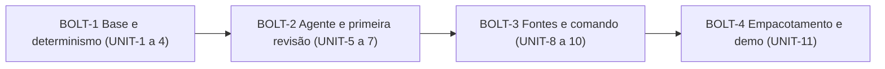

# Tasks — farejador-pr-reviewer

## 2.9 Delivery plan

- **Verification command:** `uv run ruff check . && uv run ruff format --check . && uv run mypy src && uv run pytest --cov=farejador --cov-fail-under=80`  (approved 2026-11-20 by human)
- A ordem segue o DAG de `design.md § 2.7`. Walking skeleton: **não** há skeleton separado; seguimos a ordem topológica e a primeira revisão ponta a ponta fecha na UNIT-7, onde sugiro um teste manual com um PR real num repositório de teste. [src: Q-2.9]
- Layout de código previsto (Construction pode ajustar sem mudar contratos): `src/farejador/{config,log,models,dispatcher,workspace,tools,cli}.py`, `state/`, `github/`, `review/`, `agent/`, `sources/`, `tests/`.
- Regras para todas as tarefas: cabeçalho padrão em todo arquivo-fonte; código, comentários, logs e commits em inglês; GitHub e OpenRouter sempre mockados (M-003); commits direto na `main` com Conventional Commits.

### Bolts

Legenda: cada bolt termina com o comando de verificação passando para todas as suas Units.

#### BOLT-1 — Units: UNIT-1, UNIT-2, UNIT-3, UNIT-4 — Dono: Lucas
- **Meta:** projeto com CI e toda a parte determinística pronta (config, estado, GitHub, diff, filtros, validação).
- **Definição de Pronto:** verificação passa; CI roda lint, tipos, testes e SonarCloud na `main`; testes de idempotência, ETag, âncoras e sanitização verdes.
- **Hipótese de confiança:** alta; nada depende do modelo.
- **Riscos e sequenciamento:** SonarCloud exige que o usuário crie o projeto e o token (dependência externa); UNIT-3 mockada depende de formatos reais da API do GitHub, validados mais tarde com o App real.

#### BOLT-2 — Units: UNIT-5, UNIT-6, UNIT-7 — Dono: Lucas
- **Meta:** o agente revisa um diff com contexto do repositório e publica uma review inline mais resumo.
- **Definição de Pronto:** verificação passa; teste de integração da primeira revisão com mocks verde; um teste manual (fora da suíte) com PR real em repositório de teste e um modelo escolhido pelo usuário comprova SM-1, SM-2 e SM-3.
- **Hipótese de confiança:** média; a qualidade depende do modelo e dos prompts (R-1, R-2).
- **Riscos e sequenciamento:** exige GitHub App registrado e instalado e chave do OpenRouter (dependências externas); prompts few-shot serão iterados com PRs de teste.

#### BOLT-3 — Units: UNIT-8, UNIT-9, UNIT-10 — Dono: Lucas
- **Meta:** os dois modos de entrada e o comando de reavaliação funcionando.
- **Definição de Pronto:** verificação passa; polling local revisa um PR real; webhook validado com entrega simulada assinada; comando resolve um thread corrigido e só abre nova review sem pendências.
- **Hipótese de confiança:** média; GraphQL e permissões do App podem exigir ajustes.
- **Riscos e sequenciamento:** UNIT-8, UNIT-9 e UNIT-10 são independentes entre si após a UNIT-7 e podem ser feitas em qualquer ordem; testar o webhook real exige um túnel ou a VPS (fora do MVP automatizado).

#### BOLT-4 — Units: UNIT-11 — Dono: Lucas
- **Meta:** imagem, compose, CLI, README e roteiro de demo.
- **Definição de Pronto:** verificação passa; imagem constrói; os dois modos sobem via compose com variáveis de teste; README completo; avaliação manual do NFR-8 registrada após a demo.
- **Hipótese de confiança:** alta.
- **Riscos e sequenciamento:** deploy real em VPS fica fora do MVP (C-6).

### Dependências externas (ação do usuário)

| Dependência | Quando é necessária | Observação |
|---|---|---|
| GitHub App registrado e instalado em repositório de teste | BOLT-2 (teste manual) e BOLT-3 | Permissões e eventos em `design.md § 2.8 C-E`; chave privada fora do repositório |
| Chave do OpenRouter e escolha do modelo | BOLT-2 | Via `FAREJADOR_OPENROUTER_API_KEY` e `FAREJADOR_MODEL`; nunca no repositório |
| Projeto e token do SonarCloud | BOLT-1 (CI) | Token como segredo do GitHub Actions |
| Repositório de teste com PRs de demo | BOLT-2 em diante | Smells plantados e PRs limpos para NFR-8 |

## Tasks

### UNIT-1 Foundation   Status: verified (2026-11-20, exit 0)
- [x] T-1.1 Criar o projeto uv: `pyproject.toml` (Python 3.12+, dependências, ruff, mypy, pytest-cov), pacote `src/farejador`, `.gitignore` — covers NFR-10, NFR-11 — files: `pyproject.toml`, `src/farejador/__init__.py` — test: `tests/test_smoke.py` importa o pacote
- [x] T-1.2 Configurar `pre-commit` (ruff e mypy rápido) e regras de ruff e mypy estrito para o núcleo — covers NFR-10, M-002 — files: `.pre-commit-config.yaml`, `pyproject.toml` — test: verificação passa em projeto vazio
- [x] T-1.3 Implementar `Settings` com todas as variáveis de C-C, validações cruzadas (segredo do webhook obrigatório em `webhook` e `both`) e falha citando só o nome — covers FR-22, US-11 (AC2) — files: `src/farejador/config.py` — test: `tests/test_config.py`
- [x] T-1.4 Implementar logging estruturado com redação de segredos e `log_run(...)` com os campos do FR-23 — covers FR-23, NFR-3, US-12 (AC2) — files: `src/farejador/log.py` — test: `tests/test_log.py` com segredos sentinela
- [x] T-1.5 Criar workflow do GitHub Actions (uv, ruff, mypy, pytest com cobertura, SonarCloud) e `sonar-project.properties` — covers NFR-10 — files: `.github/workflows/ci.yml`, `sonar-project.properties` — test: `tests/test_repo_files.py` valida o YAML e os campos obrigatórios
- [x] T-1.6 Teste que garante o cabeçalho padrão (Filename, Created on, Author) em todo arquivo-fonte novo — covers prática de cabeçalho — files: `tests/test_headers.py` — test: o próprio teste
**Resumo da Unit (3.5):**
- **Arquivos:** `pyproject.toml`, `uv.lock`, `.python-version` (3.13), `.gitignore`, `.pre-commit-config.yaml`, `.github/workflows/ci.yml`, `sonar-project.properties`, `src/farejador/{__init__,config,log}.py`, `src/farejador/py.typed`, `tests/{test_smoke,test_config,test_log,test_repo_files,test_headers}.py`.
- **Como rodar:** `uv sync` e depois o comando de verificação aprovado.
- **Resultado (2026-11-20):** ruff check e ruff format --check sem problemas; mypy strict sem erros em 3 arquivos; 39 testes passando; cobertura 99,38% (mínimo 80%); exit 0.
- **Desvios:** (1) `configure_logging` ganhou o parâmetro opcional `stream` (padrão `sys.stdout`), fora do contrato original, para tornar os testes independentes da captura do pytest; (2) o `main.py` de exemplo do PyCharm foi removido com aprovação do usuário; (3) versões das actions do CI (`actions/checkout@v4`, `astral-sh/setup-uv@v6`, `SonarSource/sonarqube-scan-action@v5`) e a organização `luk3rr` do SonarCloud não foram validadas, porque o CI só roda após o primeiro push; (4) o primeiro `uv sync` ocorreu antes de existir `src/farejador` e deixou o pacote editável sem o `.pth`, resolvido com `uv sync --reinstall-package farejador`.
- **Pendências do usuário:** criar o projeto e o segredo `SONAR_TOKEN` no SonarCloud/GitHub; opcionalmente rodar `uv run pre-commit install` para ativar os hooks locais.

### UNIT-2 State and dispatcher   Status: verified (2026-11-20, exit 0)
- [x] T-2.1 Modelo `Trigger` e geração de chaves de idempotência (C-A) — covers FR-4 — files: `src/farejador/models.py` — test: `tests/test_models.py`
- [x] T-2.2 `StateStore` SQLite com DDL de C-G, `PRAGMA user_version`, migrações e `try_claim` atômico — covers FR-4, NFR-4 — files: `src/farejador/state/store.py` — test: `tests/state/test_store_claim.py`
- [x] T-2.3 APIs do store para status do gatilho, execuções, threads do bot e cursores — covers FR-4 — files: `src/farejador/state/store.py` — test: `tests/state/test_store_crud.py`
- [x] T-2.4 `Dispatcher` com `asyncio.Queue`, workers configuráveis e registro de casos de uso por `kind` — covers FR-4 — files: `src/farejador/dispatcher.py` — test: `tests/test_dispatcher.py`
- [x] T-2.5 Descartar gatilhos de `sender_login` igual ao bot e, na inicialização, marcar gatilhos `claimed/running` como `failed` (A15) — covers FR-5 — files: `src/farejador/dispatcher.py` — test: `tests/test_dispatcher_bot_and_restart.py`
- [x] T-2.6 Teste de integração: mesmo gatilho entregue duas vezes e após reabrir o store roda uma única vez — covers NFR-4, FR-4 — files: `tests/state/test_idempotency_restart.py` — test: o próprio teste
**Resumo da Unit (3.5):**
- **Arquivos:** `src/farejador/models.py`, `src/farejador/state/{__init__,store}.py`, `src/farejador/dispatcher.py`, `tests/{conftest,factories,test_models,test_dispatcher,test_dispatcher_bot_and_restart}.py`, `tests/state/{test_store_claim,test_store_crud,test_idempotency_restart}.py`; `pyproject.toml` ganhou `pythonpath = ["."]`.
- **Como rodar:** comando de verificação aprovado.
- **Resultado (2026-11-20):** ruff e format sem problemas; mypy strict sem erros em 7 arquivos; 83 testes passando; cobertura 99,55%; exit 0.
- **Desvios:** (1) `Trigger` é um modelo pydantic imutável com construtores `first_review` e `command` e validação de coerência entre `key`, `kind` e `comment_id` (além do contrato C-A); (2) a tabela `trigger` é criada com identificador entre aspas porque `trigger` é palavra reservada do SQLite, sem mudar o contrato; (3) o Dispatcher grava no estado apenas o nome da classe da exceção (nunca a mensagem), para não persistir segredos; (4) o `StateStore` ganhou `has_review_run`, `list_threads`, `get_trigger` e `fail_interrupted` como suporte às Units 7, 8 e 10; (5) helpers de teste ficaram em `tests/factories.py`, não em `conftest.py`.
- **Alteração posterior (UNIT-7):** status `skipped` e re-reivindicação de chaves `skipped` em `try_claim`; `TriggerSkipped` no Dispatcher.

### UNIT-3 GitHub access   Status: verified (2026-11-20, exit 0)
- [x] T-3.1 `GitHubAuth` (interface) e `AppAuth`: JWT RS256, installation token com cache e renovação antes de expirar — covers FR-21, US-11 (AC1) — files: `src/farejador/github/auth.py` — test: `tests/github/test_auth.py` com relógio e HTTP mockados
- [x] T-3.2 `GitHubClient` base com httpx assíncrono, cabeçalhos de versão da API, backoff para 5xx e 429, mapeamento para `GitHubApiError` e `AuthError` (C-H) — covers FR-21 — files: `src/farejador/github/client.py` — test: `tests/github/test_client_errors.py`
- [x] T-3.3 Operações de leitura: instalações, repositórios, PRs abertos, PR, diff, com ETag e tratamento de 304 — covers NFR-9, FR-6 — files: `src/farejador/github/client.py` — test: `tests/github/test_client_read.py`
- [x] T-3.4 Operações de escrita e permissões: comentários, resposta, permissão de colaborador, criar review com `comments[]` — covers FR-15, FR-16 — files: `src/farejador/github/client.py` — test: `tests/github/test_client_write.py`
- [x] T-3.5 GraphQL: listar threads de review (id, isResolved, path, line, comentários) e `resolveReviewThread` — covers FR-17 — files: `src/farejador/github/graphql.py` — test: `tests/github/test_graphql.py`
- [x] T-3.6 Obter o login do bot via `GET /app` com override por `FAREJADOR_BOT_LOGIN` — covers FR-5 — files: `src/farejador/github/client.py` — test: `tests/github/test_bot_login.py`
**Resumo da Unit (3.5):**
- **Arquivos:** `src/farejador/github/{__init__,auth,client,errors,graphql,models}.py`, `tests/github/{test_auth,test_client_errors,test_client_read,test_client_write,test_graphql,test_bot_login}.py`, `tests/factories.py` (FakeAuth e SleepRecorder); dependências `httpx` e `pyjwt[crypto]` (runtime) e `respx` (dev); `pyproject.toml` ignora linhas `...` na cobertura.
- **Como rodar:** comando de verificação aprovado.
- **Resultado (2026-11-20):** ruff e format sem problemas; mypy strict sem erros em 13 arquivos; 133 testes passando; cobertura 99,33%; exit 0.
- **Desvios:** (1) a interface `GitHubAuth` inclui `app_jwt()` e `invalidate()` além de `token_for()`, necessários para chamadas no nível do App e para a renovação em 401; (2) `graphql.py` guarda só os documentos GraphQL e os métodos `list_review_threads` e `resolve_review_thread` ficam em `client.py`; (3) acrescentei `list_installations`, `list_installation_repos`, `get_bot_login`, `can_write` e o resultado condicional `Fetched[T]` (ETag/304), que o polling e o comando vão usar; (4) a única linha não coberta em `auth.py` é a segunda checagem de cache dentro do lock; (5) formato real das respostas do GitHub só será confirmado com o App real, já que os testes usam mocks (M-003).

### UNIT-4 Diff, filters and validation   Status: verified (2026-11-20, exit 0)
- [x] T-4.1 Modelos pydantic `Finding` e `ReviewResult` conforme C-D — covers FR-12 — files: `src/farejador/review/findings.py` — test: `tests/review/test_findings.py`
- [x] T-4.2 `DiffParser`: arquivos, hunks, linhas adicionadas, removidas e de contexto, com números de linha novos e antigos — covers FR-6, US-1 — files: `src/farejador/review/diff.py` — test: `tests/review/test_diff.py` com diffs de exemplo
- [x] T-4.3 Lista de ignorados (lockfiles, gerados, binários, vendorizados, `.env`, globs extras) com motivo — covers FR-7, US-4 (AC1) — files: `src/farejador/review/filters.py` — test: `tests/review/test_ignore.py`
- [x] T-4.4 Mascaramento de segredos (chaves privadas, tokens comuns, atribuições de senha) — covers FR-19, US-6 — files: `src/farejador/review/filters.py` — test: `tests/review/test_mask.py`
- [x] T-4.5 Renderizar o diff numerado para o prompt (linhas do novo arquivo visíveis) — covers FR-13, R-1 — files: `src/farejador/review/diff.py` — test: `tests/review/test_diff_render.py`
- [x] T-4.6 `Validator` de âncoras: inline só em linhas adicionadas, demais vão ao resumo — covers FR-13, NFR-7, US-2 (AC2) — files: `src/farejador/review/validator.py` — test: `tests/review/test_validator.py` (inclui teste baseado em propriedades)
- [x] T-4.7 `Sanitizer`: neutralizar `@mentions`, remover HTML bruto, escapar fences e limitar tamanhos — covers FR-14, US-2 (AC3) — files: `src/farejador/review/sanitizer.py` — test: `tests/review/test_sanitizer.py`
**Resumo da Unit (3.5):**
- **Arquivos:** `src/farejador/review/{__init__,findings,diff,filters,validator,sanitizer}.py`, `tests/review/{test_findings,test_diff,test_diff_render,test_ignore,test_mask,test_validator,test_sanitizer}.py`.
- **Como rodar:** comando de verificação aprovado.
- **Resultado (2026-11-20):** ruff e format sem problemas; mypy strict sem erros em 19 arquivos; 247 testes passando; cobertura 99,40%; exit 0.
- **Desvios:** (1) o `Masker` por linha (com estado para blocos de chave privada) foi acrescentado, além da função `mask`, porque a renderização numerada precisa mascarar linha a linha sem mudar a contagem; (2) `LineKind.HUNK` foi adicionado para preservar os cabeçalhos de hunk na renderização; (3) a validação de âncoras devolve `AnchorResult` com `inline` e `unanchored` (com motivo); (4) o teste de propriedade usa `random.Random(1234)` com 200 casos, sem dependência extra (hypothesis); (5) dois bugs reais achados pelos testes e corrigidos no código: caminhos entre aspas no cabeçalho `diff --git` e chaves JSON entre aspas na detecção de atribuições de segredo; um teste tinha expectativa errada (linha 22, não 23) e foi corrigido.
- **Limitação conhecida:** escapes octais de nomes de arquivo citados pelo git (por exemplo `\303\251`) não são decodificados; o caminho fica literal e, nesse caso raro, os achados desse arquivo cairiam no resumo.

### UNIT-5 Workspace and repository tools   Status: verified (2026-11-20, exit 0)
- [x] T-5.1 Helper de confinamento: caminho canônico, recusa de `..`, symlinks que escapam e binários — covers FR-9, NFR-2 — files: `src/farejador/tools.py` — test: `tests/tools/test_confinement.py`
- [x] T-5.2 `read_file` com intervalo de linhas e limites de 400 linhas ou 30 KB, informando truncamento — covers FR-9 — files: `src/farejador/tools.py` — test: `tests/tools/test_read_file.py`
- [x] T-5.3 `grep` por expressão regular com limite de resultados e de padrão — covers FR-9 — files: `src/farejador/tools.py` — test: `tests/tools/test_grep.py`
- [x] T-5.4 `list_dir` com limite de 200 entradas — covers FR-9 — files: `src/farejador/tools.py` — test: `tests/tools/test_list_dir.py`
- [x] T-5.5 `Workspace`: `git clone --depth 1` do head via installation token sem persistir o token, fetch do SHA quando preciso, diretório temporário — covers FR-8 — files: `src/farejador/workspace.py` — test: `tests/test_workspace.py` com repositório git local
- [x] T-5.6 Garantir a limpeza do diretório em sucesso, exceção e cancelamento — covers FR-8, US-3 (AC3) — files: `src/farejador/workspace.py` — test: `tests/test_workspace_cleanup.py`
**Resumo da Unit (3.5):**
- **Arquivos:** `src/farejador/tools.py`, `src/farejador/workspace.py`, `tests/gitrepo.py`, `tests/tools/{test_confinement,test_read_file,test_grep,test_list_dir}.py`, `tests/test_workspace.py`.
- **Como rodar:** comando de verificação aprovado.
- **Resultado (2026-11-20):** ruff e format sem problemas; mypy strict sem erros em 21 arquivos; 317 testes passando; cobertura 99,23%; exit 0.
- **Desvios:** (1) **A23 revisada:** o `grep` usa `git grep -E` em subprocesso com timeout de 10 s, argv fixo e sem shell, em vez de Python puro, porque o padrão vem do modelo e um regex catastrófico em `re` não pode ser interrompido (R-3); o confinamento continua garantido pela resolução de caminho antes da chamada; (2) o clone é `git init` + `fetch --depth 1 <sha>` + `checkout --detach`, equivalente ao `clone --depth 1` do contrato, mas busca exatamente o SHA do head; (3) o token vai por variáveis `GIT_CONFIG_*` (cabeçalho `http.extraHeader`), nunca em argv, URL ou `.git/config`, e há teste para isso; (4) os processos `git` rodam em sessão própria e o grupo inteiro é morto em timeout ou cancelamento; o teste de cancelamento mostrou que matar só o `git` deixava helpers segurando os pipes e travava por 30 s; (5) `RepoTools.execute()` converte erros em `{"error": ...}` para o modelo ler, e `.git/` é inacessível às ferramentas; (6) `git_env()` isola o git da configuração do usuário e do sistema.
- **Alteração posterior (UNIT-7):** `RepoTools.resolve` recusa arquivos que carregam credenciais e `execute` mascara a saída de `read_file` e `grep`.
- **Limitações:** a busca por SHA depende de o GitHub permitir `want` por SHA (permitido para commits alcançáveis, como o head do PR); isso só será confirmado com o repositório real.

### UNIT-6 Agent   Status: verified (2026-11-20, exit 0)
- [x] T-6.1 Prompts: diretrizes de manutenibilidade, delimitação do diff como dado, exemplos few-shot de "sinalizar" e "não sinalizar", `PROMPT_VERSION` — covers FR-10, US-4 (AC2) — files: `src/farejador/agent/prompts.py` — test: `tests/agent/test_prompts.py`
- [x] T-6.2 Esquemas das ferramentas do modelo (C-D) e despacho para `RepoTools` — covers FR-10 — files: `src/farejador/agent/schemas.py` — test: `tests/agent/test_schemas.py`
- [x] T-6.3 `AgentRunner` com `AsyncOpenAI` apontando para o OpenRouter e o loop de tool calling — covers FR-10, US-3 (AC1) — files: `src/farejador/agent/runner.py` — test: `tests/agent/test_runner_loop.py` com modelo mockado
- [x] T-6.4 Orçamentos de passos, tokens, tempo e arquivos com parada graciosa e nota de parcial — covers FR-11, NFR-6, US-5 (AC1) — files: `src/farejador/agent/runner.py` — test: `tests/agent/test_budgets.py`
- [x] T-6.5 Validação de `submit_review` com pydantic, retentativas (até 2) e erro final `InvalidModelOutput` — covers FR-12 — files: `src/farejador/agent/runner.py` — test: `tests/agent/test_submit_review.py`
- [x] T-6.6 Modo `reevaluate` com `submit_verdicts` (A13) — covers FR-10, FR-17 (insumo) — files: `src/farejador/agent/runner.py` — test: `tests/agent/test_reevaluate.py`
- [x] T-6.7 Fixtures de modelo mockado reutilizáveis (respostas com tool calls) — covers M-003 — files: `tests/agent/conftest.py` — test: usado pelos testes acima
**Resumo da Unit (3.5):**
- **Arquivos:** `src/farejador/agent/{__init__,llm,schemas,prompts,runner}.py`, `tests/llm_fakes.py` (modelo roteirizado), `tests/agent/{conftest,test_prompts,test_schemas,test_runner_loop,test_budgets,test_submit_review,test_reevaluate,test_openrouter_client}.py`; dependências `openai` e `httpx2`.
- **Como rodar:** comando de verificação aprovado.
- **Resultado (2026-11-20):** ruff e format sem problemas; mypy strict sem erros em 26 arquivos; 385 testes passando; cobertura 99,21%; exit 0.
- **Desvios:** (1) o SDK `openai` instalado (3.57.0) usa o pacote `httpx2` em vez de `httpx`; por isso o `OpenRouterClient` aceita um `httpx2.AsyncClient` e os testes do adaptador usam `httpx2.MockTransport` (o `respx` só intercepta `httpx`); `httpx2` foi declarado como dependência direta; (2) o modo `reevaluate` valida que todos os `thread_id` enviados tenham veredicto e, no fechamento parcial, qualquer thread sem veredicto vale `fixed = false`; (3) `InvalidModelOutput` e `Budget`/`ReviewRun`/`VerdictRun` ficam em `agent/runner.py`; `ModelApiError` em `agent/llm.py`; (4) o limite de `max_files` não é aplicado pelo agente: fica para o pipeline da UNIT-7, como descrito na nota 3.1; (5) o modelo de produção só será exercitado na UNIT-7, no teste manual com o App real.
- **Riscos para o teste manual (BOLT-2):** a confiabilidade de tool calling depende do modelo escolhido em `FAREJADOR_MODEL`; modelos pequenos podem falhar em `submit_review` e cair em `InvalidModelOutput`.

### UNIT-7 First review pipeline and publisher   Status: verified (2026-11-20, exit 0)
- [x] T-7.1 `FirstReview`: elegibilidade (não-draft, sem revisão prévia no estado) — covers FR-3, US-1 (AC2, AC3) — files: `src/farejador/review/pipeline.py` — test: `tests/review/test_eligibility.py`
- [x] T-7.2 Orquestração: diff, ignorados, máscara, workspace, agente, validação e sanitização — covers FR-3, FR-6, FR-7, FR-19 — files: `src/farejador/review/pipeline.py` — test: `tests/review/test_pipeline.py`
- [x] T-7.3 `Publisher`: formatar o corpo do resumo e os comentários conforme C-F — covers FR-15, FR-14 — files: `src/farejador/review/publisher.py` — test: `tests/review/test_publisher_format.py`
- [x] T-7.4 `Publisher.post_review` com `commit_id` e `comments[]`, e registro dos threads do bot no store (via GraphQL) — covers FR-15, ADR-8 — files: `src/farejador/review/publisher.py` — test: `tests/review/test_publisher_post.py`
- [x] T-7.5 Caminho de falha: mapear exceções para resultados, postar um único aviso e marcar o gatilho como `failed` — covers FR-20, US-5 (AC2) — files: `src/farejador/review/pipeline.py` — test: `tests/review/test_failure_path.py`
- [x] T-7.6 Emitir o log por revisão com passos, tokens, duração, achados e resultado — covers FR-23 — files: `src/farejador/review/pipeline.py` — test: `tests/review/test_run_log.py`
- [x] T-7.7 Teste de integração ponta a ponta com GitHub e modelo mockados, incluindo segredos sentinela (NFR-3) e draft ignorado — covers US-1, US-2, NFR-3 — files: `tests/integration/test_first_review_e2e.py` — test: o próprio teste
**Resumo da Unit (3.5):**
- **Arquivos:** `src/farejador/review/{pipeline,publisher}.py`, `tests/pipeline_env.py` (ambiente de teste completo), `tests/review/{test_eligibility,test_pipeline,test_publisher_format,test_publisher_post,test_failure_path,test_run_log}.py`, `tests/integration/test_first_review_e2e.py`; alterações em arquivos de outras Units listadas nos desvios.
- **Como rodar:** comando de verificação aprovado.
- **Resultado (2026-11-20):** ruff e format sem problemas; mypy strict sem erros em 28 arquivos; 449 testes passando, sem avisos; cobertura 99,27%; exit 0.
- **Desvios (aprovados no gate 3.1, exceto onde indicado):** (1) **UNIT-2 alterada:** novo status `skipped` e `try_claim` volta a reivindicar uma chave em `skipped` (e só nessa); `TriggerSkipped` no Dispatcher; sem isso um PR draft consumiria a chave e `ready_for_review` seria descartado como duplicado; testes novos em `test_store_crud.py` e `test_dispatcher.py`; (2) **UNIT-5 alterada (achado pelo desenho do teste de segredos, FR-19):** a saída de `read_file` e `grep` passa pelo mascaramento antes de voltar ao modelo e arquivos que carregam credenciais (`.env`, `*.pem`, `*.key`, `id_rsa*`) ficam inacessíveis às ferramentas; (3) o `Publisher` também mascara o texto publicado, caso o modelo repita um segredo do repositório; (4) arquivos só com linhas removidas são ignorados com o motivo `no-added-lines`, e o excesso de `max_files` com `file-limit`; (5) falhas também gravam um `review_run` com o resultado `failed_*`, e `has_review_run` só considera `done` e `partial`; (6) uma fixture automática fecha os `StateStore` abertos nos testes.
- **Pendente para o teste manual (BOLT-2):** GitHub App real, repositório de teste e chave/modelo do OpenRouter; o teste ponta a ponta automatizado usa GitHub e modelo simulados (M-003).

### UNIT-8 Polling source   Status: verified (2026-11-20, exit 0)
- [x] T-8.1 Listar instalações, repositórios e PRs abertos e traduzir novos PRs elegíveis em `Trigger` — covers FR-2, US-10 (AC1) — files: `src/farejador/sources/polling.py` — test: `tests/sources/test_polling_prs.py`
- [x] T-8.2 Listar comentários novos de PR e traduzir os que contêm o gatilho em `Trigger` de comando — covers FR-2 — files: `src/farejador/sources/polling.py` — test: `tests/sources/test_polling_comments.py`
- [x] T-8.3 Persistir ETags e último comentário visto; tratar 304 sem reprocessar — covers NFR-9, US-10 (AC2) — files: `src/farejador/sources/polling.py` — test: `tests/sources/test_polling_etag.py`
- [x] T-8.4 Loop periódico com intervalo configurável e resiliência a erros transitórios — covers FR-2 — files: `src/farejador/sources/polling.py` — test: `tests/sources/test_polling_loop.py`
**Resumo da Unit (3.5):**
- **Arquivos:** `src/farejador/sources/{__init__,polling}.py`, `tests/polling_env.py`, `tests/sources/{test_polling_prs,test_polling_comments,test_polling_etag,test_polling_loop}.py`.
- **Como rodar:** comando de verificação aprovado.
- **Resultado (2026-11-20):** ruff e format sem problemas; mypy strict sem erros em 30 arquivos; 478 testes passando; cobertura 99,22%; exit 0.
- **Desvios e decisões (sem nota 3.1, conforme o plano):** (1) o ETag da lista de PRs fica em memória junto com a lista (um 304 reaproveita a lista), enquanto o ETag e o `last_seen` dos comentários de cada PR são persistidos em `poll_cursor`; persistir só o ETag da lista não adiantaria sem os dados; (2) ao ver um PR pela primeira vez, só comentários criados a partir do início do serviço são processados, para que a perda do estado não reexecute comandos antigos; depois, o cursor persistido evita perdas e repetições entre reinícios; (3) comentários editados voltam pelo filtro `since` e são descartados por `created_at < cursor`; um comentário no mesmo segundo do cursor pode voltar, mas a chave `cmd:{id}` o torna idempotente; (4) o poller não envia gatilhos de primeira revisão para PRs draft, já revisados, ou com gatilho em estado diferente de `skipped`; (5) comentários do próprio bot não geram comando; (6) falhas em um repositório ou na listagem de repositórios são contadas e não interrompem o ciclo; falhas do ciclo inteiro são registradas e o loop continua.
- **Observação sobre rate limit:** cada ciclo faz uma chamada sem condição para listar repositórios da instalação; todo o resto usa ETag. Com intervalo de 60 s isso é cerca de 60 chamadas por hora por instalação.

### UNIT-9 Webhook source   Status: verified (2026-11-20, exit 0)
- [x] T-9.1 Verificação HMAC em tempo constante sobre o corpo bruto — covers FR-1, NFR-1 — files: `src/farejador/sources/webhook.py` — test: `tests/sources/test_hmac.py`
- [x] T-9.2 Aplicação FastAPI e tradução de `pull_request`, `issue_comment` e `ping` em `Trigger` conforme C-B — covers FR-1, US-9 — files: `src/farejador/sources/webhook.py` — test: `tests/sources/test_webhook_events.py`
- [x] T-9.3 Resposta 202 imediata com enfileiramento em segundo plano — covers NFR-5, US-9 (AC1) — files: `src/farejador/sources/webhook.py` — test: `tests/sources/test_webhook_fast_ack.py`
- [x] T-9.4 Erros 400, 401 e 413 e `GET /healthz` — covers FR-1, US-9 (AC2) — files: `src/farejador/sources/webhook.py` — test: `tests/sources/test_webhook_errors.py`
- [x] T-9.5 Entrega duplicada e eventos do próprio bot processados uma única vez ou ignorados — covers FR-4, FR-5, US-9 (AC3) — files: `tests/sources/test_webhook_idempotency.py` — test: o próprio teste
**Resumo da Unit (3.5):**
- **Arquivos:** `src/farejador/sources/webhook.py`, `tests/webhook_env.py`, `tests/sources/{test_hmac,test_webhook_events,test_webhook_fast_ack,test_webhook_errors,test_webhook_idempotency}.py`; dependências `fastapi` e `uvicorn`.
- **Como rodar:** comando de verificação aprovado.
- **Resultado (2026-11-20):** ruff e format sem problemas; mypy strict sem erros em 31 arquivos; 536 testes passando; cobertura 99,10%; exit 0.
- **Decisões e desvios (sem nota 3.1, conforme o plano):** (1) o enfileiramento roda em `asyncio.create_task` mantido em `app.state.pending`, e não em `BackgroundTasks`, porque o transporte ASGI do cliente (e proxies) espera as tarefas de fundo terminarem antes de entregar a resposta; assim o 202 sai antes de o `submit` terminar (NFR-5), e o teste prova isso com um `submit` bloqueado; (2) a ordem de checagens é tamanho (413), assinatura (401), cabeçalho de evento (400) e corpo (400); um chamador sem assinatura válida nunca descobre se o corpo é válido; (3) o `submit` assíncrono que falhar é registrado em log e não altera a resposta já enviada; (4) o status `accepted` significa "recebido e enfileirado para tentativa de submissão"; duplicatas são resolvidas depois pelo Dispatcher, que é idempotente por chave; (5) eventos de PR sem `installation` (webhook de repositório, não do App) são ignorados com `no-installation`; (6) `issue` sem a chave `pull_request` é um issue comum e vira `not-a-pr` (202), não um erro; (7) o login do bot é opcional no app (o Dispatcher também filtra); (8) a documentação interativa do FastAPI (`/docs`, `/openapi.json`) está desligada.
- **Pendente para o teste manual (BOLT-3):** validar com uma entrega real do GitHub (túnel ou VPS); aqui as entregas são simuladas e assinadas pelo próprio teste.

### UNIT-10 Command handler   Status: verified (2026-11-20, exit 0)
- [x] T-10.1 Detectar o gatilho e checar a permissão do autor (write, maintain, admin) — covers FR-16, US-7 (AC1) — files: `src/farejador/commands.py` — test: `tests/commands/test_authorization.py`
- [x] T-10.2 Listar threads abertos criados pelo bot (GraphQL mais estado) — covers FR-17 — files: `src/farejador/commands.py` — test: `tests/commands/test_list_threads.py`
- [x] T-10.3 Reavaliar cada thread com o agente no head atual e obter veredictos — covers FR-17, US-7 (AC2, AC3) — files: `src/farejador/commands.py` — test: `tests/commands/test_reevaluate.py`
- [x] T-10.4 Resolver os threads corrigidos e atualizar o estado — covers FR-17 — files: `src/farejador/commands.py` — test: `tests/commands/test_resolve.py`
- [x] T-10.5 Decidir entre resposta de status (pendentes) e nova review (zero pendentes) — covers FR-18, US-8 — files: `src/farejador/commands.py` — test: `tests/commands/test_branching.py`
- [x] T-10.6 Teste de integração dos cenários do comando com mocks — covers FR-16..FR-18, US-7, US-8 — files: `tests/integration/test_command_e2e.py` — test: o próprio teste
**Resumo da Unit (3.5):**
- **Arquivos:** `src/farejador/commands.py`; alterações em `src/farejador/review/{pipeline,publisher}.py`; `tests/command_env.py` e `tests/pipeline_env.py` (campos extras no `Env`); `tests/commands/{test_authorization,test_list_threads,test_command_reevaluate,test_resolve,test_branching}.py`, `tests/integration/test_command_e2e.py`, e um teste de regressão em `tests/test_log.py`.
- **Como rodar:** comando de verificação aprovado.
- **Resultado (2026-11-20):** ruff e format sem problemas; mypy strict sem erros em 32 arquivos; 577 testes passando; cobertura 99,08%; exit 0.
- **Desvios (aprovados no gate 3.1):** (1) **UNIT-7 alterada:** `FirstReview` ganhou `review_now` (nova revisão a pedido, sem as regras de draft e de "já revisado", mas ainda recusa PR fechado) e `report_failure` público (gravar a execução como falha e postar um único aviso); `Publisher` ganhou `format_status` e `PendingThread`; (2) o handler descarta o comando, com log, quando o gatilho `first:repo#pr` ainda está `claimed` ou `running`, e um lock por PR serializa comandos concorrentes: o teste mostra que o segundo comando enxerga o thread criado pelo primeiro e só posta o status.
- **Bug real achado e corrigido:** `extra={"thread": ...}` numa chamada de log colide com `LogRecord.thread` e lançaria `KeyError`, derrubando o handler justamente quando a resolução de um thread falha; trocado por `thread_id` e criado um teste que varre o código-fonte atrás de chaves reservadas em `extra=`.
- **Observação de teste:** um arquivo de teste foi renomeado para `test_command_reevaluate.py` por conflito de nome com `tests/agent/test_reevaluate.py`; o teste de cabeçalhos exigiu corrigir a linha `Filename` (comprovando que ele funciona).
- **Pendente para o teste manual (BOLT-3):** a mutation `resolveReviewThread` e a API de permissões de colaborador só serão validadas contra o GitHub real; os testes usam respostas simuladas.

### UNIT-11 Packaging and demo readiness   Status: verified (2026-11-20, exit 0); build do Docker pendente de execução manual
- [x] T-11.1 CLI `farejador run --mode polling|webhook|both` que sobe as fontes e o dispatcher — covers FR-24, ADR-5 — files: `src/farejador/cli.py` — test: `tests/test_cli.py`
- [x] T-11.2 `Dockerfile` com `git`, usuário sem privilégios e volume para `/data` — covers FR-24, NFR-11 — files: `Dockerfile` — test: build da imagem na CI ou manual
- [x] T-11.3 `docker-compose.yml` com seleção de modo e montagem da chave privada — covers FR-24, NFR-11 — files: `docker-compose.yml` — test: `docker compose config` valida
- [x] T-11.4 README: registro do GitHub App, chave do OpenRouter, execução local e em VPS, aviso de privacidade — covers FR-24, NFR-12, US-12 (AC1) — files: `README.md` — test: revisão manual contra o checklist
- [x] T-11.5 Roteiro de demo e planilha de avaliação manual (NFR-8) com PRs de smells plantados e PRs limpos — covers NFR-8 — files: `docs/demo.md` — test: preenchido após a demo
- [ ] T-11.6 Smoke test dos dois modos via compose com variáveis de teste (script pronto, execução manual pendente) — covers NFR-11, US-12 — files: `tests/smoke/` ou script em `scripts/` — test: execução manual registrada
**Resumo da Unit (3.5):**
- **Arquivos:** `src/farejador/{app,cli,__main__}.py`, `Dockerfile`, `.dockerignore`, `docker-compose.yml`, `.env.example`, `README.md`, `docs/demo.md`, `scripts/smoke_compose.sh`, `tests/{test_app,test_cli,test_docker_files}.py`; `pyproject.toml` ganhou o script `farejador` e `omit` do `__main__` na cobertura; `OpenRouterClient.aclose`; `.gitignore` ganhou `secrets/` e `.env.smoke`.
- **Como rodar:** comando de verificação aprovado; `uv run farejador run --mode polling`; `docker compose --profile polling up --build`.
- **Resultado (2026-11-20):** ruff e format sem problemas; mypy strict sem erros em 35 arquivos; 625 testes passando; cobertura 99,19%; exit 0.
- **O que foi e o que não foi verificado:** o wiring (`build_runtime`), o ciclo de vida (`Runtime.run`, encerramento com prazo de graça, erro de uma fonte), o servidor `uvicorn` real numa porta local, o CLI (`run`, `check-config`, `healthcheck`, `version`) e os arquivos de empacotamento (compose, Dockerfile, `.dockerignore`, `.env.example`, README) são cobertos por testes automáticos. **O `docker build` e o `docker compose up` NÃO foram executados:** o Docker deste computador exige `sudo` com terminal. Isso estava previsto na A38, e o script `scripts/smoke_compose.sh` cobre a execução manual (T-11.6, ainda sem tick).
- **Decisões e desvios:** (1) `FAREJADOR_ENV_FILE` e `FAREJADOR_PRIVATE_KEY_FILE` parametrizam o compose, o que permite o teste de fumaça com variáveis descartáveis; (2) o `healthcheck` do CLI só sonda `/healthz` nos modos com webhook e lê `FAREJADOR_MODE` e `FAREJADOR_PORT` direto do ambiente, sem exigir os segredos; (3) o encerramento espera as revisões em andamento por até 30 s e depois as cancela (o dispatcher marca `failed` com `Cancelled`); (4) se a busca do login do bot falhar na inicialização, o processo sai com código 1 e mensagem curta antes de abrir o estado; (5) a versão `uv==0.13.8` do Dockerfile e as imagens base `python:3.13-slim` não puderam ser baixadas aqui para conferir.
- **Pendências manuais (BOLT-4 e demo):** rodar `scripts/smoke_compose.sh`; preencher a planilha de `docs/demo.md` com PRs reais; gravar a demo; registrar os resultados do NFR-8.

### Rastreabilidade (Unit para tarefas)

| Unit | Tarefas | FR e NFR cobertos |
|---|---|---|
| UNIT-1 | T-1.1 a T-1.6 | FR-22, FR-23, NFR-3, NFR-10 |
| UNIT-2 | T-2.1 a T-2.6 | FR-4, FR-5, NFR-4 |
| UNIT-3 | T-3.1 a T-3.6 | FR-21 |
| UNIT-4 | T-4.1 a T-4.7 | FR-6, FR-7, FR-13, FR-14, FR-19, NFR-7 |
| UNIT-5 | T-5.1 a T-5.6 | FR-8, FR-9, NFR-2 |
| UNIT-6 | T-6.1 a T-6.7 | FR-10, FR-11, FR-12, NFR-6 |
| UNIT-7 | T-7.1 a T-7.7 | FR-3, FR-15, FR-20, NFR-3 |
| UNIT-8 | T-8.1 a T-8.4 | FR-2, NFR-9 |
| UNIT-9 | T-9.1 a T-9.5 | FR-1, NFR-1, NFR-5 |
| UNIT-10 | T-10.1 a T-10.6 | FR-16, FR-17, FR-18 |
| UNIT-11 | T-11.1 a T-11.6 | FR-24, NFR-8, NFR-11, NFR-12 |

### Assumptions & open questions
- A22: Cada tarefa tem até cerca de 1 hora de trabalho; tarefas maiores devem ser divididas na Construction, registrando em `tasks.md`.
- A23: O `grep` do agente é implementado em Python sobre os arquivos de texto do clone, sem subprocesso, para manter o confinamento simples.
- A24: Os testes que dependem de `docker` (T-11.2, T-11.3, T-11.6) podem ser manuais ou na CI e não entram no comando de verificação padrão.
