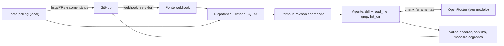

<p align="center">
  
</p>

<h1 align="center">Farejador</h1>

<p align="center">
  Revisor de código para pull requests do GitHub.
</p>

O Farejador é um agente especialista em encontrar code smells, violações de boas práticas, problemas de manutenibilidade e
provável dívida técnica nas linhas que um pull request adiciona, e publica o que encontra como
comentários de revisão. Ele auxilia os revisores humanos: nunca aprova, nunca faz alterações, nunca faz push de código e
nunca bloqueia um merge.

## Como funciona



- **Primeira revisão (automática).** Quando um pull request não rascunho é aberto, ou um
  rascunho é marcado como pronto para revisão, o Farejador publica uma revisão: comentários
  inline nas linhas adicionadas mais um resumo.
- **Interações seguintes (sob demanda).** Novos pushes **não** disparam nada. Quem tem permissão de
  escrita menciona `@farejador` em um comentário do pull request. Com threads abertos, o Farejador
  só confere se cada um foi corrigido no código atual e resolve os que foram, **sem procurar
  problemas novos**. Se todos forem resolvidos, comenta `LGTM 👍🐶`; se sobrarem, responde com um status
  curto. Sem threads abertos (por exemplo, para pedir mais depois do LGTM), uma menção faz uma nova
  revisão completa do código atual.
- **Seguro por construção.** O agente tem três ferramentas somente leitura, todo achado é conferido
  contra o diff real antes de virar comentário inline, o texto do modelo é sanitizado e os segredos
  são mascarados antes de qualquer envio ao modelo.

## Requisitos

- Python 3.12 ou superior e [uv](https://docs.astral.sh/uv/), ou Docker.
- Um GitHub App instalado nos repositórios que você quer revisar (abaixo).
- Uma chave da [OpenRouter](https://openrouter.ai) e um modelo que suporte **tool calling**.
  Modelos pequenos costumam falhar em tool calling; escolha um modelo capaz.

## 1. Registrar o GitHub App

1. GitHub → Settings → Developer settings → GitHub Apps → **New GitHub App**.
2. **Permissões** (repositório): *Contents* leitura e escrita, *Issues* leitura e escrita,
   *Pull requests* leitura e escrita, *Metadata* somente leitura. O *Contents* de escrita existe só
   porque o GitHub o exige para **resolver threads de revisão**; o Farejador nunca escreve no código:
   o token que clona o repositório é pedido só com leitura, e o de escrita só é usado ao resolver
   um thread. Sem essa permissão, o bot revisa normalmente, mas não consegue resolver os threads.
3. **Eventos assinados**: *Pull request* e *Issue comment*.
4. **Webhook**: necessário só no modo webhook. Informe a URL do seu servidor
   (`https://seu-host/webhook`) e um **segredo** longo e aleatório. Para polling, o webhook pode
   ficar inativo.
5. Crie o App, anote o **App ID** e **gere uma chave privada** (arquivo `.pem`).
6. **Instale** o App nos repositórios que serão revisados.

## 2. Configurar

Copie `.env.example` para `.env` e preencha. Nunca versione o `.env` nem o arquivo `.pem`.

| Variável | Obrigatória | Padrão | Significado |
|---|---|---|---|
| `FAREJADOR_MODE` | não | `polling` | `polling`, `webhook` ou `both` |
| `FAREJADOR_GITHUB_APP_ID` | sim | | O App ID |
| `FAREJADOR_GITHUB_PRIVATE_KEY_PATH` | sim | | Caminho da chave privada do App (`.pem`) |
| `FAREJADOR_WEBHOOK_SECRET` | modos webhook | | O segredo do webhook configurado no App |
| `FAREJADOR_OPENROUTER_API_KEY` | sim | | Sua chave da OpenRouter |
| `FAREJADOR_MODEL` | sim | | Id do modelo na OpenRouter (precisa suportar tool calling) |
| `FAREJADOR_TRIGGER_TEXT` | não | `@farejador` | Texto que aciona um comando em um comentário |
| `FAREJADOR_BOT_LOGIN` | não | derivado | Login do bot, normalmente `<slug-do-app>[bot]` |
| `FAREJADOR_POLL_INTERVAL_S` | não | `60` | Segundos entre as consultas |
| `FAREJADOR_WORKERS` | não | `2` | Revisões em paralelo |
| `FAREJADOR_MAX_STEPS` | não | `15` | Chamadas de ferramenta por revisão |
| `FAREJADOR_MAX_TOKENS` | não | `200000` | Tokens por revisão |
| `FAREJADOR_MAX_SECONDS` | não | `300` | Tempo máximo por revisão |
| `FAREJADOR_REASONING_EFFORT` | não | _(não enviado)_ | Esforço de raciocínio pedido ao modelo: `minimal`, `low`, `medium`, `high` ou `xhigh` (provedores sem raciocínio ignoram) |
| `FAREJADOR_MAX_FILES` | não | `40` | Arquivos revisados por pull request |
| `FAREJADOR_IGNORE_GLOBS` | não | | Padrões extras para ignorar, separados por vírgula |
| `FAREJADOR_STATE_PATH` | não | `/data/farejador.db` | Arquivo de estado SQLite |
| `FAREJADOR_TRACE_ENABLED` | não | `true` | Grava o trace de cada revisão (mensagens, ferramentas, achados) |
| `FAREJADOR_TRACE_PATH` | não | `/data/trace.db` | Arquivo SQLite do trace, separado do estado |
| `FAREJADOR_TRACE_RETENTION_DAYS` | não | `30` | Dias até a limpeza automática do trace (1 a 365) |
| `FAREJADOR_TRACE_MAX_ITEM_CHARS` | não | `20000` | Tamanho máximo de cada texto guardado; o excedente é cortado |
| `FAREJADOR_TRACE_MAX_RUN_BYTES` | não | `2097152` | Teto de bytes de texto por revisão |
| `FAREJADOR_HOST` / `FAREJADOR_PORT` | não | `127.0.0.1` / `8080` | Endereço do webhook (a imagem Docker usa `0.0.0.0`) |
| `FAREJADOR_LOG_LEVEL` | não | `INFO` | Nível de log (os logs são JSON na saída padrão) |

Confira a configuração sem iniciar nada:

```bash
uv run farejador check-config
```

## 3. Executar

### Localmente, por polling (sem endpoint público)

```bash
uv sync
export FAREJADOR_STATE_PATH=./data/farejador.db   # o padrão é pensado para o Docker
set -a; source .env; set +a
uv run farejador run --mode polling
```

### Com Docker (a mesma imagem para os dois modos)

```bash
mkdir -p secrets && cp /caminho/do/seu-app.pem secrets/app.pem
cp .env.example .env                              # depois edite
docker compose --profile polling up --build       # local, polling
docker compose --profile webhook up --build -d    # servidor, webhook na porta 8080
```

O contêiner roda como usuário sem privilégios e com o sistema de arquivos raiz somente leitura;
só o volume `/data` (o estado SQLite) e um `/tmp` com limite de tamanho (checkouts temporários)
são graváveis.

### Em um servidor (modo webhook)

O Farejador não provisiona servidores. Na sua própria VPS: rode o perfil `webhook`, coloque na frente
da porta 8080 um proxy reverso que termine TLS (Caddy ou nginx) e aponte a URL do webhook do App para
`https://seu-host/webhook`. Para testar o modo webhook no seu computador, exponha a porta 8080 com um
túnel como `cloudflared` ou `ngrok` e use essa URL nas configurações do App.
`GET /healthz` devolve `{"status": "ok"}` para monitoramento.

### Painel e API de leitura

No modo `webhook` o serviço também serve um painel público e somente leitura em `/` e a
[API de leitura](docs/api.md) em `/api/`, só com repositórios públicos. Veja [docs/painel.md](docs/painel.md).

## Como usar

1. Abra um pull request (fora de rascunho) em um repositório onde o App está instalado. A revisão
   aparece em até um intervalo de polling, ou na hora no modo webhook.
2. Corrija o que concordar e faça push. Nada acontece sozinho.
3. Comente `@farejador` no pull request (é preciso ter permissão de escrita). Os threads corrigidos
   são resolvidos e, se todos forem, você recebe `LGTM 👍🐶` (sem nova revisão do código); caso
   contrário, um comentário de status lista o que ainda está pendente. Resolva você mesmo os threads
   de que discordar e mencione de novo. Para uma nova revisão completa depois do LGTM, mencione de
   novo: sem threads abertos, o Farejador revisa o head atual.
4. Se uma revisão falhar (por exemplo, erro do modelo), você recebe um único aviso curto. Mencione
   `@farejador` para tentar outra vez.

### O que cada comentário contém

Todo thread que o Farejador abre segue a mesma estrutura, em português:

```markdown
**média · complexidade**

## Problema
Um parágrafo curto descrevendo o que foi encontrado.

▸ Racional        (aba minimizada)
  Por que é de fato um problema, os impactos e os riscos.

▸ Sugestão        (aba minimizada)
  A mudança sugerida e por que ela faz sentido. Quando é curta, vem também o código
  no formato do git:

  - linha a apagar
  + linha a adicionar
```

O bloco com `-` e `+` é só uma ilustração, não o botão "Commit suggestion" do GitHub. Antes de
mostrá-lo, o Farejador confere se as linhas a apagar existem de fato no código do pull request; se
não existirem, o bloco é omitido e só o texto da sugestão aparece.

Arquivos que nunca são revisados: lockfiles, arquivos gerados e de terceiros, binários, arquivos
removidos e arquivos que normalmente guardam credenciais (`.env`, `*.pem`, `*.key`, `id_rsa*`).

## Privacidade e segurança

- **O código sai da sua máquina.** O diff e qualquer arquivo do repositório lido pelo agente são
  enviados à OpenRouter e ao modelo que você escolheu. Use apenas em repositórios que você pode
  compartilhar com esse provedor.
- **Segredos são mascarados** antes do envio (chaves privadas, formatos comuns de token, atribuições
  como `password=...`) e arquivos de credenciais nunca são legíveis pelo agente. O mascaramento é uma
  rede de segurança, não uma garantia: não versione segredos.
- **O agente é somente leitura**: lê arquivos, busca e lista diretórios dentro de um checkout do head
  do pull request. Não executa código, não escreve e não acessa a rede.
- **Texto não confiável**: o conteúdo do pull request e dos arquivos do repositório é tratado como
  dado. A saída do modelo é validada contra o diff e sanitizada (menções, HTML, imagens, links
  arriscados) antes de ser publicada.
- **Limites** de passos, tokens, tempo e arquivos restringem o custo e a duração de cada revisão.
- Requisições de webhook só são aceitas com um HMAC `X-Hub-Signature-256` válido; comandos de quem
  não tem permissão de escrita são ignorados em silêncio.

## Idioma

Os comentários que o Farejador publica no pull request e os prompts do agente estão em português do
Brasil.

## Desenvolvimento

```bash
uv sync
uv run ruff check . && uv run ruff format --check . && uv run mypy src \
  && uv run pytest --cov=farejador --cov-fail-under=80
```

Os testes nunca chamam o GitHub nem a OpenRouter: ambos são substituídos por dublês.
`scripts/smoke_compose.sh` é uma verificação manual do empacotamento Docker.

## Limitações

- Uma revisão por gatilho: não há nova revisão automática a cada push, por decisão de projeto.
- A qualidade depende do modelo. Comentários inline só são publicados em linhas que o pull request
  adiciona; todo o resto vai para o resumo.
